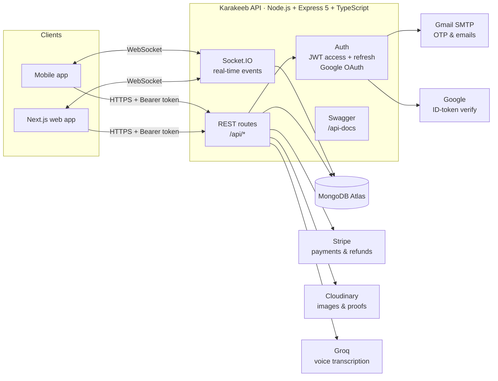
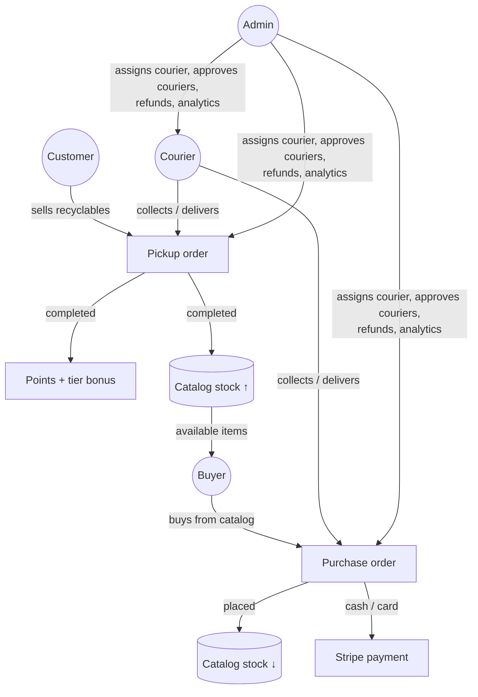
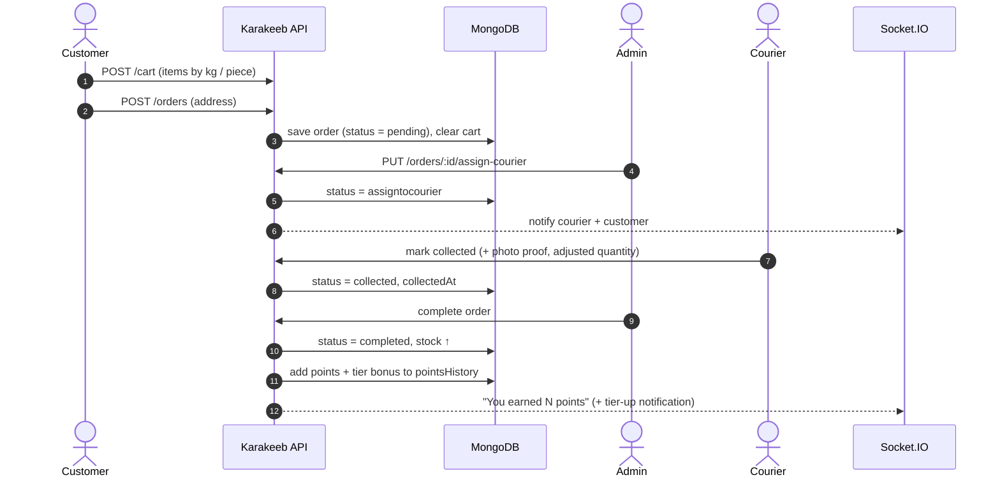
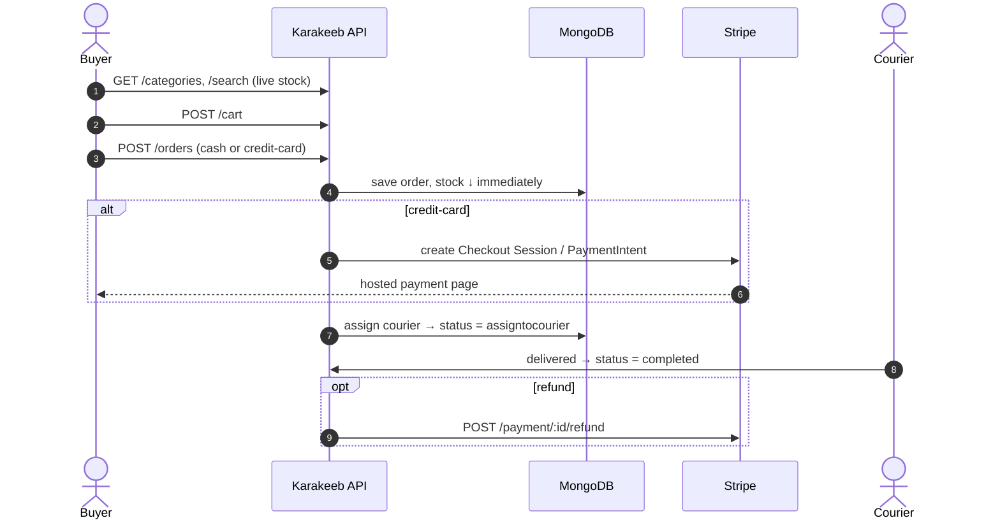
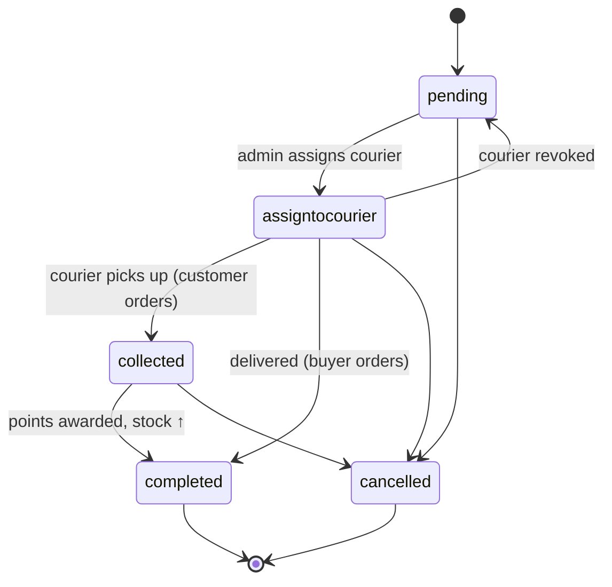
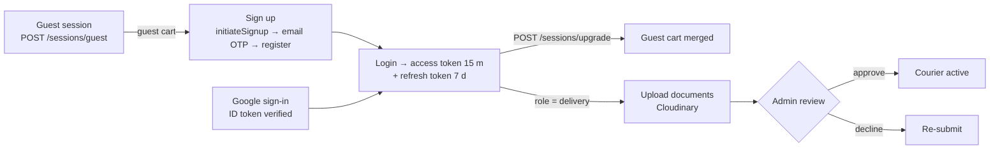

# Karakeeb — Recycling Marketplace API

> **Recycle at home, earn points, and buy recycled goods.** One REST + WebSocket API that serves the Karakeeb web app (Next.js) and mobile app.

[](https://recycling-backend-4nqw.onrender.com/api/categories)
[](https://recycling-backend-4nqw.onrender.com/api-docs/)


| | |
|---|---|
| **Live API** | https://recycling-backend-4nqw.onrender.com |
| **API docs (Swagger)** | https://recycling-backend-4nqw.onrender.com/api-docs/ |
| **Web app (Next.js)** | [Ahmed-Bakr611/Karakeeb](https://github.com/Ahmed-Bakr611/Karakeeb) |

> Hosted on Render's free tier: the first request after a quiet period can take ~50 s while the server wakes up.

---

## What it does

Karakeeb connects **households that have recyclables** with **buyers who want recycled materials**, and the **couriers** who move them. The backend owns the whole business:

- **Customers** list recyclables (by kg or piece), schedule a pickup, and **earn points** when it is completed. Points grow through **7 reward tiers**.
- **Buyers** browse the recycled-goods catalog, order from live stock, and **pay cash or by card (Stripe)**.
- **Couriers** apply with documents, get approved by an admin, then collect or deliver orders with photo proof.
- **Admins** assign couriers, approve couriers, adjust quantities, issue refunds and see analytics (top cities, top materials, points leaderboard).

---

## Architecture



---

## Roles at a glance



---

## Flow 1 — Customer recycles and earns points



### Reward tiers

| Tier | Completed orders | Bonus per order | One-time tier-up bonus |
|---|---|---|---|
| Eco Beginner | 0–4 | 1 | 50 |
| Eco Starter | 5–14 | 5 | 150 |
| Green Helper | 15–29 | 10 | 300 |
| Silver Recycler | 30–49 | 15 | 500 |
| Gold Guardian | 50–74 | 20 | 700 |
| Platinum Pioneer | 75–99 | 25 | 850 |
| Diamond Elite | 100+ | 30 | 1000 |

---

## Flow 2 — Buyer purchases recycled goods



---

## Order status machine

The allowed transitions depend on who placed the order. Every change is written to `statusHistory`.



---

## Flow 3 — Sign-up, sessions and courier approval



---

## Tech stack

| Area | Tools |
|---|---|
| Runtime | Node.js 22, Express 5, TypeScript |
| Data | MongoDB Atlas, Mongoose |
| Auth | JWT (access + refresh), Passport, Google OAuth 2.0, email OTP |
| Real time | Socket.IO (notifications, stock updates) |
| Payments | Stripe (Checkout, PaymentIntents, refunds) |
| Files | Cloudinary (images, courier documents, proof photos) |
| Email | Nodemailer + Gmail |
| Voice | Groq (speech-to-text for voice input) |
| i18n | Arabic / English messages |
| Docs | OpenAPI 3 + Swagger UI |
| Hosting | Render (API), MongoDB Atlas (DB) |

---

## API overview

Full, interactive reference: **[/api-docs](https://recycling-backend-4nqw.onrender.com/api-docs/)**

| Area | Main endpoints |
|---|---|
| Auth | `POST /auth/initiateSignup`, `/auth/verifyOtp`, `/auth/register`, `/auth/login`, `/auth/refresh`, `/auth/logout`, `/auth/provider/google` |
| Sessions | `POST /sessions/guest`, `POST /sessions/upgrade` |
| Catalog | `GET /categories`, `/categories/get-items/:name`, `/search`, `/categories/search-suggestions` |
| Cart | `GET/POST/PUT /cart`, `POST /cart/save`, `DELETE /cart/:id` |
| Orders | `POST /orders`, `GET /orders`, `PUT /orders/:id/status`, `PATCH /orders/:id/cancel`, `PUT /admin/orders/:id/status` |
| Couriers | `PUT /orders/:id/assign-courier`, `GET /my-orders`, `PATCH /delivery/approve/:userId` |
| Points | `GET /users/:id/points`, `/users/points/leaderboard` |
| Payments | `POST /users/:id/create-checkout-session`, `GET /payment`, `POST /payment/:id/refund` |
| Notifications | `GET /notifications`, `/notifications/unread-count`, `PATCH /notifications/mark-read` |
| Analytics | `GET /orders/analytics`, `/orders/analytics/top-cities`, `/top-materials-recycled` |

---

## Run locally

```bash
git clone https://github.com/Ahmed-Bakr611/Recycling-BackEnd.git
cd Recycling-BackEnd
cp .env.example .env        # fill in MongoDB, JWT secrets, Google, Stripe, Cloudinary, Gmail, Groq
npm ci
npm run dev                 # http://localhost:5000  ·  docs at /api-docs
```

Production build: `npm run build && npm start`.

---

## Team & my part

ITI graduation project (2025), team of 5: Sarah Hesham, **Ahmed Bakr**, Hazem Abdelrahman, Esraa Ahmed, Jihan Ahmed.

**What I built (Ahmed Bakr):**
- **Authentication:** JWT access/refresh tokens, sessions, Google OAuth on web and mobile, welcome notifications
- **Rewards:** the 7-tier points system, tier-up bonuses, points history and e-wallet transactions
- **Cart & stock:** whole-cart save, stock checks, admin order filtering
- **Search** endpoints and OpenAPI docs
- **Deployment and maintenance:** production setup on Render + Atlas, secret rotation and history clean-up (2026)
